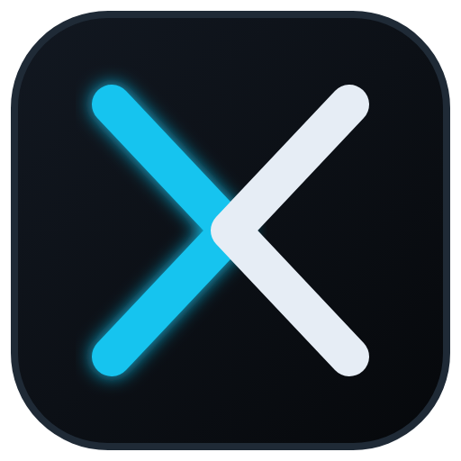

<h1 align="center">MapSim</h1>

<b>Planeamento e simulação de videomapping e LED walls</b> <i>Projection mapping &amp; LED wall planning and simulation · Windows</i>

  
  

---

Instaladores do **MapSim** (simulador de videomapping para Windows) de Daniel Nunes — [github.com/NunesDanielPT](https://github.com/NunesDanielPT).

## ⬇ Download

**[Descarregar o MapSim para Windows (última versão)](https://github.com/NunesDanielPT/MAPSIM-releases/releases/latest/download/MapSim-Setup.exe)**

Este link dá sempre a versão mais recente. Notas de cada versão: [Releases](https://github.com/NunesDanielPT/MAPSIM-releases/releases).
Depois de instalada, a app avisa quando há uma versão nova e mostra as novidades antes de actualizar.
A app precisa de uma chave de licença fornecida pelo autor.

---

**English:** [Download MapSim for Windows (latest version)](https://github.com/NunesDanielPT/MAPSIM-releases/releases/latest/download/MapSim-Setup.exe) — this link always gives the newest version. A licence key from the author is required.

## Conteúdo do repositório

- **Releases**: instaladores e actualizações automáticas da app.
- `data/db.json`: base de dados de projectores e lentes (specs oficiais dos fabricantes), actualizada automaticamente na app.
- `data/changelog.json`: novidades de cada versão (PT/EN).
- `server/`: servidor de licenças (Docker).
